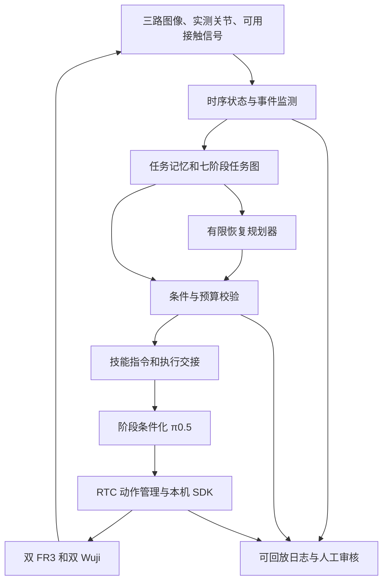

# 番茄采摘 Agent 落地路线 v0.2

日期：2026-11-09。状态：讨论稿；包含本次已确认决策，其余建议不视为已裁决或已验证。

本文承接《番茄采摘Agent设计与定义_人工审核版_v0.1.md》，补充算法、后训练、现有部署接入、实验和交付路线。原稿保留，不在本次直接修改训练、数据转换或真机控制代码。

## 1. 本次已确认与待确认

| 项目 | 状态 |
|---|---|
| 在线阶段规则 | 用户已确认：保留七阶段语义，允许满足条件后的重复和跳过 |
| 首版硬件 | 用户已确认：双 FR3＋双 Wuji，54 维 |
| 模型现状 | 用户已确认：已有七阶段标注，尚未验证分阶段训练模型 |
| S5/S6 的轮次含义 | 按上述在线规则，设计为再次拿起/后续采摘；保留原始标签，轮次单独记录 |
| 首版场景 | 暂沿用 v0.1：右盘已有整串番茄，右手支撑，左手摘取并放入左篮；不是田间寻果或剪串 |
| 果实范围与质量 | 暂沿用 v0.1：全部初始目标果实；跳过难果不能算整串完成；具体损伤标准待定 |
| 接触观测 | RGB、关节数据以外的在线力矩、电流、触觉及其可用性待确认 |
| 自主恢复范围 | 建议首版验证“停滞→脱离→放回→调整→再拿起→继续采摘”；尚未完成能力验证 |

允许某条任务图路径不等于允许当前模型立即在真机执行。需要分别确认任务规则、技能可执行性、边界检测和控制交接。

## 2. 核心方案

采用“时序状态估计＋带条件的任务图＋有限恢复规划＋阶段条件化 VLA＋独立执行控制”。

Agent 的输出是当前应该执行的技能及其条件，不是任意关节轨迹。π0.5 的输出是动作，不单独承担完整任务结果判定。视觉语言模型解释异常并提出候选，确定性校验器决定候选是否可执行。



`stduy.txt` 中的 Plan-and-Execute 可以用于短期恢复计划；ReAct 的“观察—选择工具—检查结果”可以用于非实时决策循环。首版不需要多个互相对话的 Agent，也不需要先引入通用 Agent 框架。最值得投入的是可靠事实、可执行技能和交接协议。

高层规划只在阶段完成候选、无进展、观测冲突、恢复结束等事件触发时运行，辅以周期复核。每次只执行下一项已批准技能，其余步骤都是可撤销的计划。

## 3. 从已有任务和代码中确认的事实

本次阅读了聊天《检查数据处理包运行环境》《执行 Pi05 真机部署测试》《梳理 FastRTC 部署链路》的相关近期记录，并核对了以下本地代码。聊天中的历史实测结果不当作当前硬件在线状态。

### 3.1 数据转换链

- 自动转换、七阶段自动标注、人工修订和审核后导出已有工作基础。
- `src/convest/annotation/stages.py` 的 `validate()` 强制每个 Episode 有且仅有七段，按固定顺序连续覆盖。
- S1/S5 指令文字相同，S2/S6 指令文字相同；阶段身份和动作技能身份本来就不完全相同。
- 已审核数据可以训练正常动作和提供阶段监督，但没有因此自动获得逐果事件、失败原因或恢复示教。
- 历史聊天记录中已有单条经过审核的 LeRobot v2.1 包导出。是否满足本次训练加载器、动作语义及时间要求，仍需训练前验收。

### 3.2 当前 π0.5 部署主线

```text
pi05-server 模型服务
    ↕ WebSocket 推理请求和动作响应
li-agent-mono 的 Pi05Policy / FrankaWujiAdapter
    ↓ Pi05Controller / streaming runtime
lia-robots 的本体接口和控制后端
    ↓ 双 FR3、双 Wuji
```

当前相应配置是 54 维、50 步动作窗口、30 Hz 模型时间轴；执行配置中控制层默认 100 Hz。模型窗口覆盖约 1.67 秒，但 RTC 可以提前刷新，不能把窗口长度当作必须完整执行的时长。上述数值不能泛化为所有 π0.5 权重的固有要求。

主要接入位置：

| 位置 | 已有能力 | 本任务需要增加或验证 |
|---|---|---|
| `pi05-server/src/pi05_server/profiles.py` | Full/LoRA 配置 | 区分固定全任务指令和阶段条件化指令合约 |
| `pi05-server/src/pi05_server/runtime.py` | 输入输出变换、归一化、指令编码 | 阶段指令确实进入 tokenizer，且与训练一致 |
| `lia-policies/lia_policies/pi05/client.py` | `Pi05Policy.act()`、WebSocket 客户端、模型合约检查 | 请求/响应关联技能版本，拒绝过期结果 |
| `lia-policies/lia_policies/pi05/adapters/franka_wuji.py` | 图像、状态、指令映射与动作顺序转换 | 沿用适配器；不在 Agent 中手写 54 维下标映射 |
| `lia-workbench/.../pi05_franka_wuji/streaming.py` | 读观测、推理与控制组装 | 接入监督器和动态技能指令，定义跨进程交接 |
| `lia-policies/.../pi05/execution/inference.py` | 新鲜观测检查、RTC 前缀构造 | 前缀只能来自仍有效且允许延续的技能版本 |
| `lia-policies/.../pi05/execution/timeline.py` | 动作块接纳和时间轴 | 技能切换时旧时间轴失效及交接确认 |
| `lia-robots` | 只读观测、控制、停止与反馈接口 | 验证停止效果、持物保持及恢复准入 |

### 3.3 两个必须优先处理的接口问题

**固定 prompt 覆盖。** 当前 Full profile 的 `override_prompt=True`，`policy_transforms()` 会加入 `OverridePrompt(prompt)`。因此，客户端虽然从 `observation.instruction` 发送 `prompt`，服务端仍可能用启动时的固定任务指令覆盖。Full 适配器还校验全任务 prompt 元数据。新阶段模型需要独立声明合约，不能只修改一个客户端字符串，也不能无条件解除所有权重的约束。

**reset 不负责控制交接。** 当前 `Pi05Policy.reset()` 调用客户端 `reset()`，而 `Pi05WebsocketClient.reset()` 的实现是 `pass`。它不会停止机械臂，不会清除执行时间轴，也不能防止旧推理结果迟到后被接纳。

因此，第一个工程验收应是离线记录三项内容：Agent 选择的指令、客户端实际请求的指令、服务端真正编码的指令。三者一致以后，才讨论阶段模型的行为效果。

## 4. 七阶段、技能和监督状态分开设计

| 阶段 | 语义 | 核心完成证据 |
|---|---|---|
| S1 | 第一次拿起 | 右手稳定持串，串到达可采摘区域 |
| S2 | 第一轮采摘投放 | 本轮需要调整或已摘完；已持果处理完，左手可交接 |
| S3 | 放回番茄串 | 串得到右盘支撑，右手释放 |
| S4 | 调整番茄串 | 形成下一次拿取的有效起点；不能只证明手动过 |
| S5 | 再次拿起 | 调整后的串稳定到达采摘区域 |
| S6 | 后续采摘投放 | 已摘完或需要再次恢复；持果和接触已处理 |
| S7 | 放回裸杆 | 确认无残留，裸杆放稳、释放、双手完成收尾 |

推荐技能库：`lift_truss`、`pick_and_deposit`、`return_truss`、`reposition_truss`、`return_bare_stem`；另外登记 `disengage_left`、`deposit_held_fruit`、`observe` 等必要恢复能力。登记不代表已有可用模型。

S1/S5 共享拿起技能、S2/S6 共享采摘投放技能是起始方案；记忆负责区分轮次。先训练一个共享阶段条件化模型，如验证显示共享干扰明显，再比较分技能模型或 adapter。

同时记录：

- `commanded_stage`：已被执行端确认接纳的阶段命令。
- `observed_activity`：监测器判断机器人实际在做什么。
- `proposed_stage`：尚未完成交接的候选阶段。
- `supervision_state`：执行、验证、观察、恢复、等待人工或停止等管理状态。

命令已接纳也不等于物理动作已经发生。需要另外记录执行开始和实际行为一致性。

### 4.1 已获原则认可的任务图

```text
正常示教：S1 → S2 → S3 → S4 → S5 → S6 → S7
第一轮摘完：S1 → S2 → S7
后续重摆：S6 → 脱离/持果处理 → S3 → S4 → S5 → S6
预算耗尽：S2/S6 → 必要退出动作 → S3 → 未完成退出
```

不是每条任务都要经过每个节点。S3 放回带果串用于失败退出，不能被记成 S7 裸杆收尾。

## 5. 如何判断阶段边界

阶段分类只回答“像哪种动作”，阶段完成还要回答“目标是否实现、当前能否交接”。边界判定采用三层证据。

### 5.1 几何与运动证据

利用标定后的盘、篮、工作区域，实测关节状态，以及图像中的手与物体运动关系，判断接近、搬运、释放、让位和停滞。

需要验证相机角色、时间同步和坐标系。模型能接收图像不等于已有三维定位能力；如没有深度或可靠标定，相应几何谓词应降低覆盖范围或保持 UNKNOWN。

### 5.2 因果时序事件

S2/S6 内至少识别：接近目标、建立接触、尝试分离、分离后持果、向篮搬运、投放确认、失败退出、结果不明。

先以多视角短视频和人工审核建立基线，再训练或微调因果时序监测器。输入只包含当前与过去的图像特征、实测状态和历史事件，输出：

```text
observed_activity
物理谓词 TRUE / FALSE / UNKNOWN
事件候选及其时间区间
观测有效性和冲突
证据索引
```

可先比较简单规则＋VLM 复核与轻量时序分类器，再根据数据量选择 TCN、因果 Transformer 等。首版不预设某个网络结构必然优于规则。

当前命令可以作为上下文，但不能替代观测标签。应专门测试“命令放回但实际仍在采摘”的样本，防止监测器直接复述 prompt。

### 5.3 任务条件校验

普通阶段完成候选通过稳定时窗、滞回和条件检查后才允许切换。时窗按事件类型标定，不统一写死为若干帧。

以 S2 → S3 为例：

```text
仍有果实或残留状态未能排除
且确实需要重摆/退出
且左手无未处理持果
且左手已退出接触并让位
且右手支撑可靠、右盘可接收
且起始姿态在放回技能验证范围内
且关键证据有效、预算允许
→ 才能申请放回
```

其中任何必要项 UNKNOWN 都不能视作满足。观察动作也必须是已验证能力；无接触信息时不能用猜测替代脱离确认。

### 5.4 哪些现象不算完成

- 手指闭合不等于抓住。
- 手往外移动或力突然下降不单独证明果实分离。
- 手在篮上方张开不单独证明投放成功。
- 检测器暂时没有看到番茄不等于裸杆。
- 机器人有运动不等于任务有进展。
- 同一张图交给两个模型判断不构成两个独立物理证据来源。

## 6. 对未见情况如何恢复

不把“准确识别所有分布外场景”作为启动恢复的前提。优先检测能被验证的后果：无进展、目标仍连接、支撑不稳、动作与命令不一致、观测不明或结果无法核实。

OOD/不确定性分数可以触发复核，但不能直接推出“应该进入 S3”。未知情境能否处理取决于是否存在适用的已验证技能组合。

### 6.1 有限规划器

输入：当前事实、证据时效、最近尝试、目标和轮次、剩余预算、可用技能及其起始范围。

输出：异常类别、下一步技能、前提、完成判据、失败去向、简短理由和证据引用。首版语言模型只能从有限集合中选，不生成任意 SDK 调用代码。

候选优先级：处理控制/接触异常 → 处理已持果 → 澄清未知 → 已验证局部重试/换目标 → 重摆 → 受控退出或人工。

“换目标”只有在执行层能够可靠接收目标指示时才能开放。单纯有果实 ID 的高层记忆，不能证明 π0.5 能指定采摘该果；需要验证文字、视觉标记或目标条件接口及相应训练。

### 6.2 你提出的典型失败

```text
正在 S6，目标果实连续尝试仍未分离
  → 事件监测报告无进展，保留同一目标/区域尝试记录
  → 判断左手是否已经持有分离果实
      是：先完成持果投放，不能直接搬回整串
      未知：补充观察或人工处理
      否：检查当前接触，调用已验证脱离能力
  → 验证左手让位、右手稳定、盘可接收
  → 执行 S3，并验证真正放稳
  → 执行 S4，验证摆放或可接近性发生有效改善
  → S5 再拿起，S6 再采摘
  → 检查是否产生新的分离/投放进展
```

若仍无改善且预算已耗尽，条件允许时放回并记录 PARTIAL/FAILED；状态无法确认则 UNRESOLVED/人工裁定。不能通过重命名阶段或新建目标 ID 清空失败历史。

重复次数沿用 v0.1 的数字仅作待标定候选，不把“2次”“4次”当成已经确认的项目要求。持续拉扯必须另受无进展时长和本地控制约束，不能等一次完整失败事件结束才处理。

## 7. π0.5 后训练路线

### 7.1 首先证明语言可控，而不是直接训练完整 Agent

训练输入需要真正使用当前技能指令，包含三视角、实测状态、与设备合约一致的动作监督。逐帧存在 `stage_index` 并不能证明训练加载器使用了阶段语言。

首个模型验收由人工指定阶段：在可重复布置、对两个候选技能均有效的起点，分别下达“继续采摘”“放回番茄串”等指令。检查有效指令日志和实际行为。离线动作差异只能发现指令被忽略等问题，不能代替实机技能成功验证。

如果人工指定正确阶段仍不能完成，应先补动作数据、修正加载器或训练配置；此时增加规划复杂度没有解决低层能力缺口。

### 7.2 数据分为四种用途

| 数据 | 学习内容 | 处理原则 |
|---|---|---|
| 正常七阶段示教 | 基础动作、正常阶段事件 | 继续使用已审核数据 |
| 困难成功和失败片段 | 区分慢但可完成与真正停滞 | 完整保留，不把失败动作无筛选地作为成功模仿目标 |
| 恢复示教 | 从真实异常起点脱离、投放、放回和重摆 | 必须包含恢复前状态与恢复后验证 |
| Agent 运行及人工接管轨迹 | 找出错误决策、补监测和动作能力 | 标明控制来源，人工纠正段经审核后回流 |

已有成功示教可以提供边界监督，但无法单独教会“拉不下来之后怎么退出”。建议优先补采失败后的脱离、中途已持果投放、非标准持串姿态下放回三类能力。

监督器、规划器和 VLA 分开更新。先用经过审核的示教做行为克隆后训练和人工纠正回流；是否引入 RL，应在奖励/结果判定可靠、基础恢复稳定后另行比较，不作为首版依赖。

### 7.3 动作窗口不能错误跨越阶段

当前 50 步窗口约覆盖 1.67 秒。若帧 t 的指令是采摘，而监督动作尾段来自下一阶段的放回，训练可能混淆“继续当前技能”和“自主切换”。

应比较两类明确的训练设计：

1. 基线保留连续窗口，测量边界附近提前切换与指令跟随效果。
2. 技能条件化窗口限制于相应技能片段，明确处理有效长度、终止和边界样本。

第二种不能只重复末帧假装真实动作：需要确认训练器是否支持动作有效掩码，或采集真实技能完成后的稳定行为并使用相应监督。简单删除所有边界附近样本会损失终止能力，也不应作为未经评估的默认处理。

采样按技能和事件覆盖平衡，避免长采摘段淹没短放回/调整段。S1/S5、S2/S6 以技能共享为起点，轮次不是必须让低层记住的隐式时间线。

### 7.4 原始时间与数据切分

- normal 与 speedup 用途区分；无进展阈值、持续接触和事件延迟必须映射回真实时间。
- 同一原始 Episode 的切片、不同视角和加速变体必须在同一数据划分中。
- 测试集按采集批次、番茄串形态、摆放和失败类型分组，避免相邻帧泄漏。
- 离线标注可参考未来画面，但另标“最早在线可判断时刻”，在线评测不能读取未来。
- 监测标签允许 UNKNOWN、边界区间和标注分歧；需要抽样双人复核关键事件。

### 7.5 新增运行数据协议

保留现有七段成功协议，另增可变长度的运行/恢复协议，例如 `tomato-agent-episode-v1`（提案名，尚未实现）。字段至少包括：

```text
episode_id, source_recording_id, schema_version
model_version, rule_version, calibration_version
stage_index, skill_id, stage_visit_id, round_id, stage_epoch
attempt_id, target_id_or_region, control_source
event_type, physical_onset, observable_onset, detected_at
predicate_values, evidence_refs, unknown_reason
recovery_reason, recovery_result, remaining_budget
final_result, human_intervention, quality_flags
```

运行协议允许阶段重复、提前结束、失败中止和人工接管。对实际发生的行为如实记录，即使它违反当前许可任务图；合规验证报告错误，不能因此删除原始失败证据。

## 8. Agent 与现有执行链如何交接

新增监督器可放在 `new/agent` 项目，执行适配复用 mono。读取统一观测快照，避免监督器另抢设备控制权；控制仍由单一执行端持有。

### 8.1 建议的能力接口（新设计，非现有 API 声明）

| 接口 | 作用 |
|---|---|
| `observe_snapshot()` | 获取对齐的图像、状态、采样时间及当前命令版本 |
| `read_execution_status()` | 查询正在执行的技能、动作块、已执行范围和故障 |
| `request_skill_transition()` | 提交期望旧版本、新技能、依据、有效期限及条件 |
| `cancel_pending_transition()` | 取消尚未生效的计划，不假定能撤回已执行运动 |
| `request_controlled_stop()` | 交给执行层进行与当前接触兼容的停止/保持 |
| `record_review()` | 记录人工确认、否决、接管与恢复依据 |

请求中的技能由白名单映射成训练过的规范指令。VLM 可以提出解释，但不能临时改变关节维度、频率、动作语义、限值或相机顺序。

### 8.2 切换协议

1. 监督器根据最新证据提出切换；命令中携带当前 `stage_epoch`，旧版本请求拒绝。
2. 执行端进入切换等待态，阻止旧阶段产生新的可执行普通请求。
3. 完成必要的已验证脱离/投放等退出技能；失败则停止普通切换并升级处理。
4. 由控制端确认可交接状态，使旧阶段尚未执行动作和迟到响应失效。已执行动作不能被软件回滚。
5. 在确认后的实测状态下更新技能版本，获得新鲜观测并运行新技能推理。
6. 新动作满足模型合约、时效与起始条件后才接纳；记录命令接纳、物理执行开始和结果。
7. 任一环节超时或条件变化，撤销候选，使用适当保持/退出策略，不能继续使用过期计划。

`stage_epoch` 是语义控制版本，需贯穿监督、请求、结果封装、动作接纳和日志；不一定需要修改模型输入张量或底层 WebSocket 协议。执行端必须再次检查版本，不能只在高层检查。

同技能连续刷新可沿用有效 RTC 前缀；语义切换时不能直接把旧采摘尾段作为新放回的前缀。首版先完成明确交接后重新播种推理，后续再评估允许的连续切换。运动平滑器的状态如何重新衔接需依据实测位置/速度和控制器契约设计，不能一律清零，也不能一律继承旧目标。

正常完成、异常恢复和本地紧急停止走不同路径。持果或接触中，“停下”不默认等于松手、断电或回 Home。`body.stop()` 的接口确认还需结合物理状态核查；不能仅因为收到回执就假定接触已经解除。

### 8.3 计算与时序

硬件控制不等待语言模型返回。规划超时不延长旧动作无限执行。

本地已有 100 Hz 控制层与 30 Hz 模型时间轴。监测器、VLM 和 VLA 的实际刷新频率另行测量；不能把 30 Hz 动作采样率说成模型每秒完成 30 次推理。

测量观测采集→检测→规划→交接→实际旧行为停止的端到端延迟，报告 P50/P95/P99 及超时。若监测 VLM 与 π0.5 共用 GPU，单独压测资源争用；可先异步低频复核，必要时另机部署高层模型。

## 9. 按验收关卡推进，而不是先承诺成功率

| 关卡 | 工作与交付物 | 通过依据 |
|---|---|---|
| G0 规则与观测 | 硬件/传感器清单、任务规则、关键事件定义 | 能说明每个必要事实由什么观测支持；未知项有处理方式 |
| G1 数据和指令链 | 单条已审数据的训练加载审计、动态 prompt 合约 | 实际训练指令、推理有效指令、动作布局和时间一致 |
| G2 人工阶段驱动 | 共享阶段模型、各技能起点与结果清单 | 人工指定正确阶段时，技能在声明范围内可完成、可退出 |
| G3 离线监督 | 因果回放、事件标注、错误案例集 | 能区分困难成功和停滞，错误切换/漏检/延迟可量化 |
| G4 在线影子 | 实时建议与人工对照报告 | 真实观测延迟、遮挡和计算争用下仍可用 |
| G5 正常闭环 | L1 人工确认，随后 L2 正常自动 | 正常交接、提前摘完和旧响应拒绝分别通过验证 |
| G6 首条恢复 | 停滞→脱离→放回→调整→再采摘 | 起点覆盖、每步完成和恢复后采摘改善均通过验证 |
| G7 失败回流 | 人工纠正数据、监测与策略新版本 | 新版本对同一留出场景有收益，原有能力无明显退化 |

关键依赖是 G2：动作模型从有效起点不听阶段指令，就不能靠 G3 的边界检测弥补。G3 的数据标注和回放工作可与模型训练同期推进，但不能跳过动作验收。

首个有意义的闭环演示应同时展示：正常完整采摘；一次真实无进展被识别；经过验证的重摆后恢复；无法恢复时正确退出。仅展示阶段号变化不是验收。

## 10. 评估如何证明 Agent 有用

对照：A 全任务 VLA；B 人工指定正确阶段的条件化 VLA（辅助上限，不计全自主）；C 自动边界＋规则，无自主恢复；D 完整监督与有限恢复。

在相同目标范围、时间预算、质量标准和可比场景下随机化试验顺序；采摘不可逆，应使用匹配的多串重复试验，不能声称在同一串上重复完全相同初态。

报告：

- 无人工干预的整串完成率；人工辅助完成率另报。
- 单颗采摘投放率、掉落和损伤、去向不明比例。
- 各异常检测的精确率/召回率、每分钟误报、在线检测延迟。
- 过早切换、错误切换、正确交接和 UNKNOWN 比例。
- 恢复步骤完成率，以及恢复后真正新增采摘进展的比例。
- 总耗时、自主耗时、恢复耗时、人工时间和介入次数。
- 旧响应被拒绝、过期观测、队列耗尽和控制异常等执行指标。

未决、失败和取消不能悄悄从主分母删掉；模型版本和场景分层、样本量及置信区间一起报告。

专项用例应包含：部分遮挡误判裸杆；长时间但最终成功的困难采摘；已摘下未投放；左手仍接触时请求放回；新阶段接纳后旧响应迟到；暂停后人工移动物体；推理超时；整串预算耗尽。

数值门槛在基线试验后按应用需求裁决。没有实验数据时不承诺“完美”或某个成功率；目标是每项错误可定位、每条恢复有证据、效果可重复验证。

## 11. 建议的首版代码边界

以下是拟议结构，尚未创建运行代码：

```text
new/agent/
  docs/                 规则、裁决、模型与数据合约
  schemas/              观测、事实、决策、事件和交接记录
  perception/           时序事件与物理谓词
  supervisor/           任务图、记忆、预算、校验
  planner/              有限恢复候选与结构化 VLM 调用
  skills/               能力登记、规范指令、验证范围
  adapters/lia_mono/    只读观测与执行交接适配
  replay/               按真实时间的因果回放
  evaluation/           标注对比与验收报告
```

首轮实现优先交付离线回放和影子监督；训练与服务端只做经过合约定义的必要扩展。执行层需要编写真正有价值的交接测试，特别是迟到结果、过期观测、重复命令和中途取消。

## 12. 后续逐项裁决顺序

已裁决：在线重复/跳过；FR3＋Wuji；当前尚未验证阶段条件化模型。

后续依次明确：

1. 实际可稳定读取的力矩、电流、触觉、深度与时间戳；如果仅 RGB＋关节，明确接触未知的人工边界。
2. 当前已有的失败片段、人工接管录像和恢复示教；哪些需要补采。
3. 首版是否采用共享阶段模型、有限恢复菜单和影子→人工确认→自主的开放路线。
4. “摘不下来”后的业务选择：局部重试/换目标/整串重摆的优先级，以及允许的部分完成退出。
5. 果实质量、时间预算、重试预算和量化验收标准。

每次用户裁决新增记录；未答项保留建议状态，不以默认选项已显示或经过等待视为批准。

## 13. 资料与适用范围

本地依据：

- [v0.1 行为定义](/home/user/ty/new/agent/番茄采摘Agent设计与定义_人工审核版_v0.1.md)
- [七阶段校验](/home/user/ty/new/data-auto-processing_subtask/src/convest/annotation/stages.py)
- [服务配置](/home/user/lpy/pi05-server/src/pi05_server/profiles.py)
- [模型输入变换](/home/user/lpy/pi05-server/src/pi05_server/runtime.py)
- [Full 模型适配](/home/user/lpy/pi05-server/src/pi05_server/adapters/full.py)
- [π0.5 客户端](/home/user/lpy/li-agent-mono/lia-policies/lia_policies/pi05/client.py)
- [Wuji 适配器](/home/user/lpy/li-agent-mono/lia-policies/lia_policies/pi05/adapters/franka_wuji.py)
- [Streaming 组装](/home/user/lpy/li-agent-mono/lia-workbench/lia_workbench/experiments/pi05_franka_wuji/streaming.py)
- [RTC 新鲜观测与前缀](/home/user/lpy/li-agent-mono/lia-policies/lia_policies/pi05/execution/inference.py)
- [本体 SDK 说明](/home/user/lpy/li-agent-mono/lia-robots/README.md)

外部研究用于说明设计背景，不作为本系统已实现能力的证明：

- [Hi Robot 官方研究说明](https://www.pi.website/research/hirobot)：将高层视觉语言决策与低层 VLA 动作分开，为本方案的分层结构提供参考；本文额外提出任务条件、预算、执行交接等工程约束。
- [π0.5 官方介绍](https://www.pi.website/blog/pi05)：研究系统包含高层语义和低层动作预测；不能据此推定本地导出的动作 checkpoint 已提供阶段判定接口。
- [OpenPI 官方仓库](https://github.com/Physical-Intelligence/openpi)：当前 README 对 π0.5 说明支持 flow-matching head 的训练与推理。因此首版高层监测/规划单独设计，不假设可直接从现有动作服务读取语义决策。

本次完成的是设计与源码核对，没有启动真机、运行后训练或验证恢复成功率。
